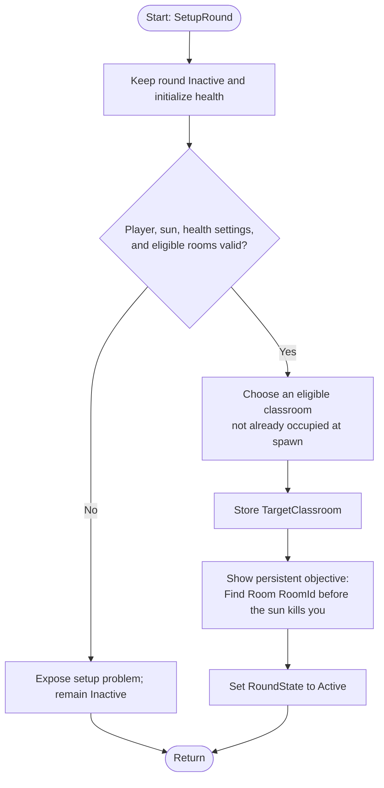
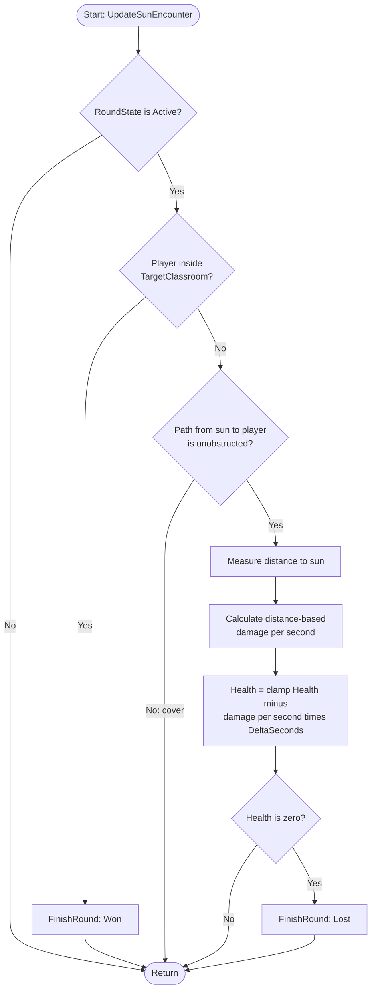

# shepfinalproj — What If the Sun Was Inside PFT?

Final project for 4330.

But is it TRULY the final project?

## What we are making

A survival-and-navigation game inside the digital twin of **Patrick F. Taylor Hall (PFT)** at LSU. At the beginning of a round, the player receives a specific classroom to find. A dangerous indoor "sun" threatens the player while they navigate the building. Reaching the assigned classroom wins; losing all health before reaching it loses.

The building is an existing Unreal project, not a model we need to recreate. Our work is to make the existing environment playable and add the encounter, classroom objectives, HUD, and round lifecycle.

### Status and how to read this document

- **Implemented in this repository:** design documentation, a [player quickstart](docs/player-quickstart.md), and a [reusable bug report template](.github/ISSUE_TEMPLATE/bug-report.md). No playable sun encounter, Unreal source, or building assets have been committed here.
- **Verified from the supplied archive:** the project structure and configuration in [Existing digital twin](#existing-digital-twin).
- **Agreed design baseline:** the concept and gameplay rules below. These describe intended behavior, not working code.
- **Proposed implementation:** the Unreal architecture, interfaces, and development sequence. Agents should inspect the actual project before applying them.
- **Open decisions:** listed explicitly near the end. Do not silently turn them into new requirements.

## Gameplay baseline

1. Assign an eligible classroom at round start.
2. Show a persistent objective: **"Find Room {RoomId} before the sun kills you."**
3. While the round is active, check whether the player has reached that classroom.
4. Otherwise, check whether building geometry blocks the path between the sun and player.
5. Unobstructed exposure causes damage; closer exposure causes more damage.
6. Walls provide cover. The baseline has no passive damage through blocking walls.
7. Reaching the assigned classroom wins immediately. Entering another classroom does not.
8. Zero health loses the round.
9. **Within an encounter update, classroom success is checked before damage.** Reaching safety and taking a potentially lethal hit in that update must resolve as a win.
10. Damage is time-based, not frame-count-based.

This is a gameplay approximation, not a physically accurate simulation of a star inside a building. Looking away from the sun does not provide cover: exposure is a world-space obstruction check, not a camera visibility check.

## Existing digital twin

The supplied `PFTDigitalTwin.zip` was inspected without extracting the full project or launching Unreal.

| Item | Verified finding |
| --- | --- |
| Project descriptor | `PFTDigitalTwin/PFTDigitalTwin.uproject` |
| Engine association | `5.8` |
| Included editor build | Unreal **5.8.2**, according to `Binaries/Win64/PFTDigitalTwinEditor.target` |
| Project type | Native C++ module `PFTDigitalTwin`, with Blueprint/content assets |
| Startup and default map | `/Game/Level/PatrickFTaylorHall.PatrickFTaylorHall` |
| Configured game mode | `/Game/Blueprints/UnrealCore/BP_PFTGameModeBase.BP_PFTGameModeBase_C` |
| Configured game instance | `/Script/PFTDigitalTwin.PFTGameInstance` |
| Archive size | Approximately 6.94 GB compressed / 8.53 GB uncompressed, using decimal GB |
| File count | 115,506 files, including many external actor/object packages |
| Custom plugins included | `DigitalTwinTools`, `DMAEEditorToolsPlugin`, and content plugins |

Other maps include `MEP`, `L_MeshEdit`, and `RobotVehicleTest`. The archive also contains tour, room-search, area-trigger, UI, and food-delivery-related source files. Their presence does **not** prove that movement, room detection, collision, or existing missions meet this game's needs.

The building's geometry, classroom labels, collision, lighting, performance, and original gameplay have **not yet been verified in the editor**. Successful compilation and compatibility with a local engine installation also remain unverified.

### Asset handling

- Keep the original archive unchanged as a baseline.
- Extract the **whole project**, including `Content`, `Config`, `Source`, and `Plugins`. Do not copy only the hall's `.umap`: much of its content is stored in separate external actor/object packages.
- Do not rename or manually reorganize imported building assets. Unreal references can break; use editor-supported operations when a move is necessary.
- Do not commit the ZIP, engine installation, credentials, generated caches, or build output.
- This repository is public. Confirm permission to redistribute the digital twin and its third-party content **before** publishing assets.
- Decide the shared project/asset distribution method before multiple agents begin implementation. If assets will be versioned here, agree on Git LFS and Unreal asset handling first; this README does not establish that policy.

## Local setup

1. Obtain the supplied archive from the team's agreed location. It is not included in this repository.
2. Use **Unreal Engine 5.8.2** if available, matching the included build. Confirm the team's exact version before converting or saving the project in another engine version; changing `EngineAssociation` alone does not make assets or plugins compatible.
3. Prepare a Windows C++ toolchain and Windows SDK supported by that engine. Although our game logic can be Blueprint-first, the underlying project and custom plugins contain C++.
4. Extract outside OneDrive or other sync folders, using a short path such as:

   ```text
   C:\UnrealProjects\PFTDigitalTwin\PFTDigitalTwin.uproject
   ```

   The ZIP already contains a `PFTDigitalTwin` folder, so choose the extraction destination accordingly.

5. Leave room for the archive, extracted assets, engine, shader/derived-data caches, and build output. The 8.53 GB extracted size is not the total development footprint.
6. Open `PFTDigitalTwin.uproject`. If Unreal reports incompatible or missing modules, use the matching engine/toolchain to regenerate project files and build the editor target. Diagnose actual errors; do not remove plugins or native dependencies merely to bypass startup failures.
7. Open the configured `PatrickFTaylorHall` map, let required compilation finish, and test the existing experience in Play In Editor.
8. Record the working engine version, build steps, and any confirmed setup fixes in this README.

**First editor check:** locate a usable starting area and classroom, verify walking-scale dimensions, floors, walls, doors, stairs, and a safe player spawn. A visually correct twin is not automatically a playable level.

## Proposed Unreal architecture

Use **Blueprint-first gameplay on top of the existing C++ project**. New C++ is appropriate only where it is actually needed. These are proposed names, not files that already exist.

Prefer one new gameplay folder such as `/Game/SunEscape/`, with `Blueprints`, `UI`, and `Maps` subfolders. Keep the original hall and original gameplay available. Inspect the current game mode, player controller, pawn, game instance, and room data before replacing or duplicating their responsibilities.

| Component | Proposed responsibility |
| --- | --- |
| `BP_SunEscapeGameMode` | Own round state, target classroom, health, round setup, encounter updates, and terminal transitions. Preserve or derive from existing game-mode behavior where necessary. |
| Existing playable pawn, or `BP_SunEscapeCharacter` if needed | Movement, collision, input, and a defined exposure sample point. No independent damage loop. |
| `BP_IndoorSun` | Sun visuals and the world-space exposure origin. Start with a designer-placed position; movement is an open design decision. |
| `BP_ClassroomGoal` | A designer-placed room volume with a unique `RoomId` and eligibility setting; supports an explicit containment check for the player. |
| `WBP_SunEscapeHUD` | Persistent target-room text, health display, and win/loss presentation. Reads gameplay state; does not decide outcomes. |

Use a dedicated test map or a controlled map/game-mode override to integrate the encounter. Do not overwrite the original default mode, game instance, or hall content just to get an initial demonstration working.

### State and interface contract

The initial proposal is a **single-player** encounter. Multiplayer, replication, and multiple simultaneous players are not assumed.

| Field | Owner | Contract |
| --- | --- | --- |
| `RoundState` | Game mode | Enum: `Inactive`, `Active`, `Won`, `Lost`. |
| `TargetClassroom` | Game mode | Reference to one eligible `BP_ClassroomGoal`; its `RoomId` supplies the objective text. |
| `Player` | Game mode | The controlled player pawn/character used for both containment and exposure checks. |
| `Sun` | Game mode | Reference to the encounter's `BP_IndoorSun`. |
| `Health`, `MaxHealth` | Game mode | Health stays in `[0, MaxHealth]`; damage has one owner. |
| Damage tuning | Game mode | Designer-editable near/far distances and near/far damage rates, with documented Unreal units. |
| `RoomId`, `Eligible` | Classroom goal | Human-readable room identifier and whether the room may be assigned. |

Proposed function boundaries:

- `SetupRound()`: initialize the round, choose/store the target, initialize the HUD, then activate the encounter.
- `UpdateSunEncounter(DeltaSeconds)`: perform the ordered success, exposure, damage, and failure checks.
- `ContainsPlayer(Player)`: answer whether the player's agreed reference point is inside the target room volume.
- `FinishRound(Result)`: transition once to `Won` or `Lost`, stop encounter damage, and update the HUD.

**One active update source, one damage owner, one terminal transition.** Do not implement a second damage timer on the sun, player, or HUD.

The game mode must not enter `Active` without a valid player, sun, target, and positive `MaxHealth`. If setup is invalid, keep it inactive and expose the actual setup problem rather than silently starting an unwinnable round.

## Function 1: round setup

This runs **once at round start**, not every frame. Choosing and displaying the target belongs here; the encounter loop only checks the assigned target.

Before activation, initialize health to `MaxHealth` and select from an explicitly configured list of eligible classroom goals. Initially, designers should verify those rooms are reachable; automatic reachability discovery is not required. Do not assign the room the player already occupies at spawn.



The HUD remains visible during play. It should not recreate the objective widget or reselect the classroom on each update. The initial selection policy—random versus a fixed designer choice—is still open.

## Function 2: sun encounter update

For the first implementation, use one gameplay update driven by Unreal's frame delta. If this is later moved to a timer, use the actual elapsed interval and retain the same ordering.



### Room detection and update ordering

- Give each eligible room a correctly sized, unique goal volume. Do not infer classroom identity from arbitrary mesh names.
- Define containment consistently. Proposed baseline: the player's actor location is inside the configured room box; whole-body entry is not required.
- Use overlap events for auxiliary notifications if useful, but evaluate current target containment before applying damage. Do not rely on two unrelated overlap/damage callbacks happening in a favorable order.
- Schedule the encounter evaluation after player movement so it uses the updated position. Verify tick ordering in the actual pawn/movement implementation.
- `Won` and `Lost` are terminal until an explicit new round. Later damage or overlap callbacks must not reverse the outcome.

### Exposure and damage

- Proposed baseline: a **single line trace** between a defined sun origin and a stable point on the player, such as torso height.
- Configure a dedicated trace channel such as `SunExposure`, or an explicitly verified existing channel. Walls, floors, and other intended cover must block it.
- Ignore the player's own collision and the sun's decorative mesh for this query. Visual brightness or camera-facing direction is not the damage test.
- First establish that opaque walls stop damage. Glass, doors, railings, and small props need deliberate collision/cover decisions.
- A single sample point creates predictable but coarse cover behavior. Partial-body exposure or multiple samples are not required by the baseline.
- Proposed simple tuning model: interpolate linearly from a near damage rate to a far damage rate between near/far distances, clamping outside that interval. Near damage must be greater than far damage, distances must be ordered, and rates must be nonnegative.
- Use Unreal world units consistently; standard Unreal distances are centimeters. Do not mix room dimensions in meters with raw trace distances.
- Apply `DamagePerSecond * DeltaSeconds` and clamp health to `[0, MaxHealth]`. Keep the constants designer-editable; their final values are not decided.
- No healing, heat meter, damage-through-walls, finite damage cutoff, or escalating difficulty is part of the current baseline.

## Implementation sequence and acceptance gates

These are steps toward the full game, not separate claims that the project is already working.

### 1. Establish the runnable baseline

- Extract and open the matching project; resolve real build/plugin issues.
- Walk through the hall and record collision, scale, spawn, and performance problems.
- Inspect existing room/area-trigger data and player controls for reusable behavior.
- **Gate:** Play In Editor loads the actual hall and the player can reach at least one verified classroom without falling through geometry.

### 2. Add classroom objectives and round setup

- Establish the dedicated gameplay mode and a small, designer-verified set of goal volumes.
- Implement `SetupRound`, target storage, health initialization, and the persistent objective HUD.
- **Gate:** the displayed room ID matches the stored target; the target is reachable and not the spawn room; entering another room does not win.

### 3. Add the sun and survival rules

- Add visible sun geometry/effects separately from damage logic.
- Implement the exposure trace, distance-based damage, health UI, and `FinishRound`.
- **Gate:** clear exposure damages, cover prevents damage, closer exposure is more dangerous, the target wins, and zero health loses.

### 4. Validate the complete lifecycle

- Verify movement/update ordering and success-before-damage behavior.
- Define and implement an explicit restart/new-round action, resetting health, target, HUD, and active update state without duplicate widgets or damage loops.
- Expand the eligible room list only after verifying routes and room volumes.
- Profile the actual hall on the team's hardware before making broad rendering or asset changes.
- **Gate:** a new round works after either terminal outcome, and the full agreed encounter works in the real building.

### 5. Package and share

- Build a runnable Windows package using the agreed engine version and distribution method.
- Verify the hall, required plugins, assets, input, HUD, win/loss, and new-round behavior in the packaged build—not only in the editor.
- Record launch instructions and remaining known issues here.
- Packaging does not imply permission to redistribute the building; resolve asset permissions before public distribution.

## Verification checklist

Agents must record what they actually exercised, including the engine version and relevant map. Do not claim a feature is complete because a Blueprint compiles or a source file exists.

| Scenario | Expected result |
| --- | --- |
| Begin a valid round | Full health, one assigned classroom, one visible objective, `Active` state. |
| No eligible target or missing required reference | Round remains `Inactive`; setup problem is visible to the developer. |
| Enter a non-target classroom | No victory. |
| Enter the target classroom | One victory transition; encounter damage stops. |
| Enter target with health low enough for the next hit to be lethal | Victory takes precedence over that update's damage. |
| Remain exposed at a fixed distance | Health decreases according to elapsed time. |
| Compare near and far unobstructed exposure | Near exposure causes a greater damage rate. |
| Stand behind a blocking wall | No exposure damage. |
| Look away while unobstructed | Exposure still causes damage. |
| Compare exposure at different frame rates for equal elapsed time | Approximately equal health loss, allowing for frame-boundary sampling. |
| Reach zero health outside the target | One defeat transition; health does not become negative. |
| Continue receiving callbacks after victory/defeat | Outcome stays unchanged; damage remains stopped. |
| Start another round after either outcome | Clean health/objective/state; no duplicate update sources or HUD widgets. |
| Run the packaged build | Required map/assets/plugins load and the same rules hold. |

Use actual in-editor and packaged gameplay for smoke verification. Add automated tests where they protect real state transitions or boundary behavior, not merely to assert that named components exist.

## Handoff rules for group members and their agents

1. **Inspect before editing.** This repo currently documents a separate archive. Locate the actual Unreal checkout, read its instructions, and inspect its current changes before assuming source paths or assets exist here.
2. **Preserve the twin.** Do not delete original missions, change the global game instance, strip plugin dependencies, or mass-resave the hall as incidental cleanup.
3. **Agree on contracts before splitting work.** Use the ownership/state/function contracts above, or record a deliberate revision before dependent agents implement different versions.
4. **Keep one owner per binary asset.** Coordinate changes to maps, Blueprints, widgets, and other `.uasset` files; Git cannot normally text-merge simultaneous edits to them.
5. **Split independent work only after interfaces are stable.** Reasonable assignments are encounter state/damage; classroom volumes/data; sun visuals/exposure setup; and HUD/input integration.
6. **Do not duplicate existing systems by assumption.** Inspect the room-search, trigger, pawn, and controller implementations before deciding whether to reuse them.
7. **Keep changes scoped.** No networking, procedural building generation, real stellar physics, or replacement of the digital-twin architecture unless the team explicitly adds that scope.
8. **Report evidence.** Handoffs should name changed files/assets, state which scenarios were exercised, and identify blockers or assumptions. Unverified behavior must remain labeled.
9. **Update this README as reality changes.** Keep planned versus implemented behavior accurate; record confirmed setup instructions and any agreed design changes.

## Open decisions

- Exact indoor sun position, visible size, and whether it remains stationary or moves.
- Eligible room list, selection policy, spawn location, and accessibility of routes.
- Near/far damage distances and rates, maximum health, and intended difficulty.
- Whether glass, closed/open doors, and small props provide cover.
- Whether a timer, room hints, audio cues, or additional navigation aids are desired.
- Final input scheme, win/loss presentation, and restart interaction.
- Asset permissions, versioning/distribution method, repository layout, and build-sharing process.
- Performance target and supported hardware.

Until these are resolved, prefer the smallest implementation of the agreed loop: **one player, one sun, an assigned classroom, persistent instructions, cover-aware distance damage, and explicit win/loss states**.
