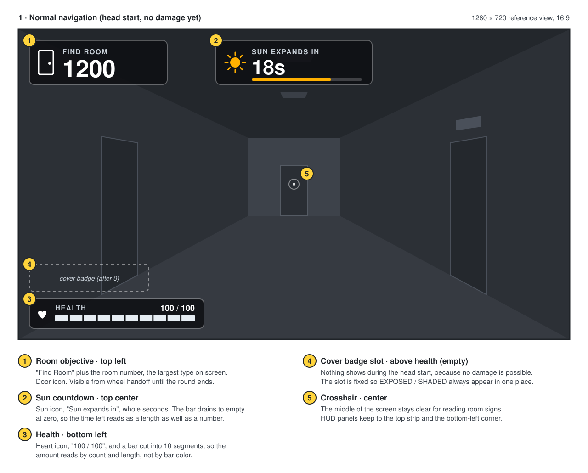
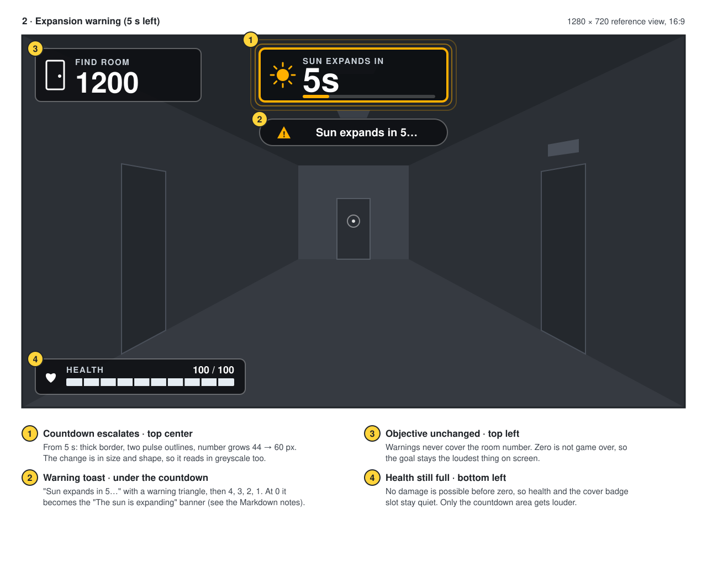
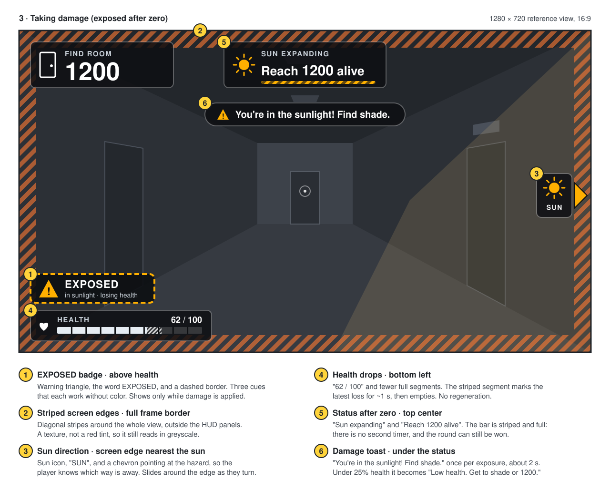
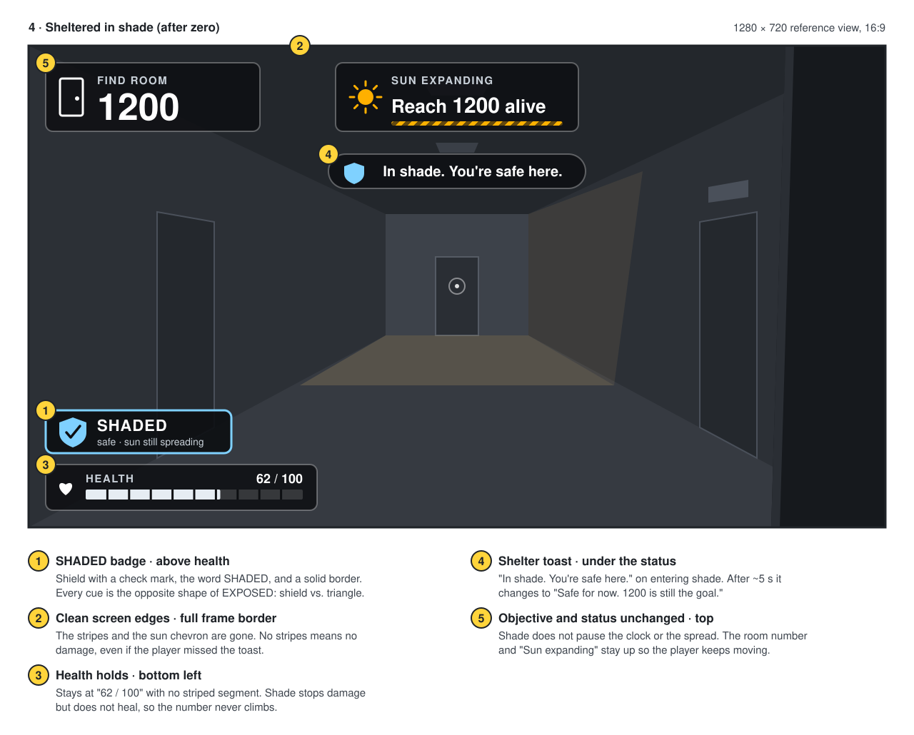

# HUD wireframes: room objective and damage states

Static, annotated wireframes for the in-round HUD. Resolves issue #23.

**Status:** design mockups for team review. Nothing here is implemented. They are a layout target for the proposed `WBP_SunEscapeHUD` widget in the [gameplay design](../gameplay-design.md). All on-screen text uses the string IDs from [Player-facing copy](player-copy.md), so wording changes belong there, not here.

Each SVG is hand-written and opens in any browser or on GitHub. Numbered yellow markers in each image match the numbered notes under it.

## Layout at a glance

The mockups use a 1280 × 720 (16:9) first-person view of a PFT corridor. The scene is drawn in grey so the HUD stands out.

| Element | Screen position | Why there |
| --- | --- | --- |
| Room objective | Top left | Read first by left-to-right readers. The room number is the largest text on screen, and the panel is never hidden. |
| Sun countdown / status | Top center | Close to the player's line of sight, so a glance up from the corridor finds it. Warnings and toasts stack directly under it. |
| Toasts | Top center, under the status | One place for short messages (≤ 40 characters, about 2 s). They never cover the objective or the crosshair. |
| Cover badge (EXPOSED / SHADED) | Bottom left, above health | It sits next to the health bar, because it explains why health is or isn't dropping. |
| Health | Bottom left | A standard spot for health in first-person games. It's out of the way of room signs and doors. |
| Sun direction chevron | The screen edge nearest the sun | Shows only while the player takes damage, and points toward the hazard so the player can move away. |
| Crosshair | Center | Kept clear so the player can read room signs and line up door checks. |

The middle of the screen stays empty. Wayfinding depends on reading PFT's room signs, so the HUD keeps to the top strip and the bottom-left corner.

## 1. Normal navigation

**When:** from wheel handoff until about 10 s before zero. No damage is possible during the head start.

- **Room objective** (`OBJECTIVE_PERSISTENT`): the "FIND ROOM" label, a door icon, and the room number in 52 px bold. This is the only element that never changes size or position during a round.
- **Countdown** (`COUNTDOWN_LABEL`): a sun icon, "SUN EXPANDS IN", whole seconds, and a bar that drains to empty at zero. The bar shows the time left as a length, so the player can judge it without reading the number.
- **Health**: a heart icon, the number as "100 / 100", and a bar split into 10 segments. The player can read health by number, by segment count, or by length, and none of them depend on color.
- **Cover badge slot**: shown dashed here only to mark where it goes. In game it is empty until after zero.

## 2. Expansion warning

**When:** the last 10 s of the countdown, getting louder at 5 s.

- At 10 s, the `COUNTDOWN_WARN_10` toast shows: "10 seconds. Find shade or get to 1200."
- At 5 s, the countdown panel **changes shape**. It gets a thick border and two pulse outlines, and the number grows from 44 to 60 px. The `COUNTDOWN_WARN_5` toast ("Sun expands in 5…") has a warning triangle. It counts down 4, 3, 2, 1.
- At 0, the toast becomes a short banner in the same spot. It shows `COUNTDOWN_ZERO_TITLE` ("The sun is expanding") above `COUNTDOWN_ZERO_SUB` ("You can still make it. Get to Room 1200."), for about 2 s. Then show **SUN EXPANDING**. Ahead of the front, keep the damage cues hidden and health steady. Use the exposed state when the front reaches an unshaded player and the sheltered state when shade protects them from the front.
- The objective and health don't change. The warning must not cover the room number, because zero doesn't end the round.

## 3. Taking damage

**When:** after zero, while the sun front reaches the player and they are not in shade.

- **EXPOSED badge** (`EXPOSURE_ICON_TOOLTIP`): a warning triangle, the word EXPOSED, a dashed border, and the subline "in sunlight · losing health".
- **Striped screen edges**: diagonal stripes around the whole view. The stripes are a texture, not a red tint, so they still read for players with color-vision deficiency or in greyscale.
- **Sun direction chevron**: a sun icon, the label "SUN", and an arrow on the screen edge closest to the sun. It moves around the edge as the player turns. The sun front spreads from the Commons, so in most cases this points back the way the player came.
- **Health**: "62 / 100" with fewer full segments. A striped segment shows the most recent loss for about 1 s and then empties. Health does not regenerate.
- **Status**: `COUNTDOWN_EXPIRED_LABEL`, shown as "SUN EXPANDING" with "Reach 1200 alive". The bar is now striped and full instead of draining, because there is no second timer. The round can still be won.
- **Toast** (`DAMAGE_EXPOSED`): "You're in the sunlight! Find shade." It shows once each time the player becomes exposed. When health drops below about 25%, `DAMAGE_LOW_HEALTH` shows once: "Low health. Get to shade or 1200."

## 4. Sheltered in shade

**When:** after zero, while the player is in shade.

- **SHADED badge** (`SHELTER_ICON_TOOLTIP`): a shield with a check mark, the word SHADED, a **solid** border, and the subline "safe · sun still spreading". Each cue is the opposite of EXPOSED: a shield instead of a triangle, a solid border instead of a dashed one, and a different word.
- **Clean edges**: the stripes and the sun chevron disappear. If the edges have no stripes, the player isn't taking damage, even if they missed the toast.
- **Health** stays at "62 / 100" with no striped segment. Shade stops damage but doesn't heal.
- **Toast**: `SHELTER_ENTER` ("In shade. You're safe here.") shows when the player steps into shade. After about 5 s in shade it changes to `SHELTER_HINT` ("Safe for now. 1200 is still the goal.") to keep the player moving.
- **Objective and status** don't change. Shade doesn't pause the clock or stop the spread.

## Readable without color or sound

Every state change is shown by at least two cues that aren't color:

| Cue | Exposed (damage) | Shaded (safe) | Before zero |
| --- | --- | --- | --- |
| Badge word | EXPOSED | SHADED | none |
| Badge icon | Warning triangle with "!" | Shield with check mark | none |
| Badge border | Dashed, 4 px | Solid, 3 px | none |
| Screen edges | Diagonal stripes | Clean | Clean |
| Direction aid | "SUN" chevron on the nearest edge | none | none |
| Health | Number drops, striped last-hit segment | Number holds | Full |

- **Color-vision deficiency.** The two state colors, amber `#ffb000` (sun, exposed) and light blue `#7fd1ff` (shade), are an orange/blue pair that stays distinct for the common red–green deficiencies. They have **almost the same brightness** (contrast ratio 1.09 to each other), so in greyscale they look nearly identical. That is why each state also has its own shape, border style, and word. Don't rely on the color alone.
- **No red/green meaning.** Health is near-white, not green-to-red, and damage is shown by stripes, not a red vignette.
- **Contrast.** HUD panels are `#0d0f12` at 85% opacity with a light outline, so they stay readable over bright sunlit floors. Measured against the panel color, the WCAG contrast ratios are white text 19.2:1, grey labels `#c9d1d9` 12.4:1, amber 10.5:1, and light blue 11.4:1. All are above the 4.5:1 AA minimum. Against the brightest sunlit area in the mockup they stay above 9:1.
- **Without sound.** Audio, such as a sizzle when exposed or a heartbeat at low health, can add to these cues but must never be the only one. Every audio event in this design already has a matching on-screen change.
- **Size.** The room number is 52 px and badge words are 22 px at 720p. Scale them with resolution, and don't go below these sizes on a 1080p TV at couch distance.

## Assumptions and open points

- **Shade feedback before zero.** These mockups hide the cover badge during the head start. Player copy [open question 2](player-copy.md#open-questions) asks whether it should show then.
- **Chevron in shade.** Hidden here to keep the safe state quiet. Showing it dimmed would help the player plan the next dash. The team should decide.
- **Damage-edge motion.** The stripes could scroll slowly while damage applies. Keep any flashing below 3 times per second for photosensitivity.
- **Health numbers.** The mockups use a maximum health of 100 as an example. The real `MaxHealth` and damage rates are still open in the [gameplay design](../gameplay-design.md).
- **Room ID format.** The mockups use `1200`. If IDs get a prefix or a letter suffix, the objective panel needs room for about 9 characters.
